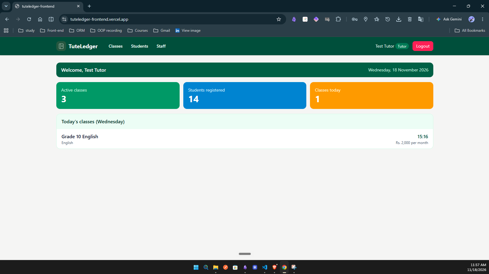
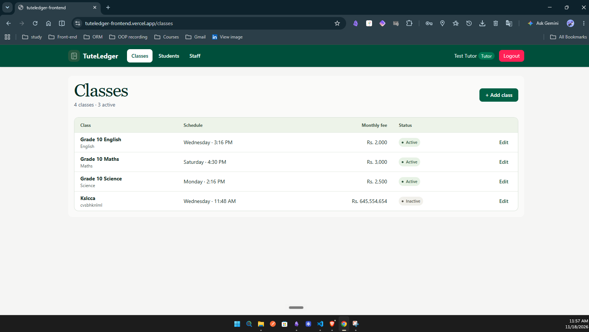
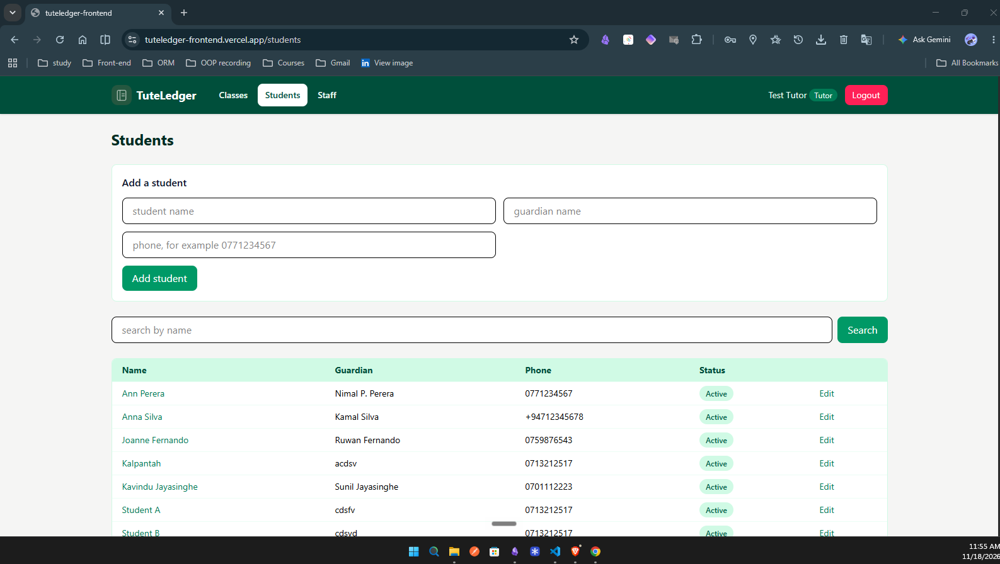
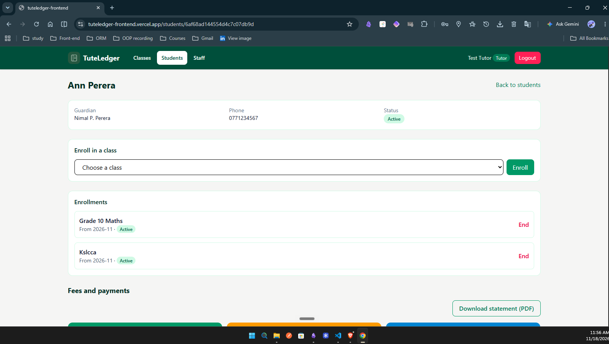

# TuteLedger: Frontend

TuteLedger is a back-office web app for private tuition tutors. A tutor records every fee payment at the moment it is received, tied to a student, a class and a billing month, so "what was paid, for what, and when?" is answered from one record that the tutor controls instead of a paper card held by the student.

This repository is the **frontend** (React + TypeScript). The REST API is in a separate repository.

| | |
|---|---|
| Live frontend | https://tuteledger-frontend.vercel.app |
| Live backend | https://tuteledger-backend.vercel.app (health check: `/api/health`) |
| Frontend repository | https://github.com/kalpanath-selvaraja/tuteledger-frontend |
| Backend repository | https://github.com/kalpanath-selvaraja/tuteledger-backend |

## Demo logins

Fictional accounts and fictional data, for marking only.

| Role         | Email                  | Password               |
| ------------ | ---------------------- | ---------------------- |
| Tutor        | tutor1@example.com     | tutor1Demo2026!        |
| Receptionist | reception1@example.com | receptionist1Demo2026! |

The Tutor sees everything. The Receptionist cannot change fees, void payments, waive months or open the Staff page.

## Technologies

- React 19 with functional components and hooks, **TypeScript**
- Vite, Tailwind CSS (responsive layout), React Router
- Axios with interceptors (attaches the token, refreshes it when it expires)
- React Context for the logged-in user. Redux is not used: the module lecturer confirmed in writing that it is optional, and all other data lives in component state loaded from the API.
- jsPDF for PDF generation
- Deployed on Vercel

## Main features

- **Login and session:** access and refresh tokens, automatic refresh when the access token expires, protected pages, and role-aware navigation.
- **Home:** today's classes and student count.
- **Classes:** list and (Tutor) add or edit classes with fee, day and time.
- **Students:** search, paging, add and edit. Each student has a detail page.
- **Enrollments:** enroll a student in a class from the student page. The Tutor can end or reopen an enrollment.
- **Ledger and payments:** every month of every class shows Paid, Waived or Unpaid. Tick unpaid months and record one payment, which makes one receipt.
- **Void and waive (Tutor):** void a payment with a reason, or waive a month with a reason. Nothing is ever deleted.
- **Staff page (Tutor):** create receptionist accounts.
- **PDF reports (advanced feature):** download a fee statement for a student, or a receipt for any payment, as a PDF. These give the guardian a second copy of proof that the tutor can reissue at any time.
- **Loading skeletons and responsive design:** works on phone, tablet and desktop.

## Screenshots

|                                        |                                          |
| -------------------------------------- | ---------------------------------------- |
|      |          |
|  |  |
|    |    |
|      |      |

## Setup and run (frontend)

Requirements: Node.js 20 or newer, and the backend running (see below).

```bash
git clone https://github.com/kalpanath-selvaraja/tuteledger-frontend.git
cd tuteledger-frontend
npm install
```

Create `.env.local` (see `.env.example`):

```
VITE_API_URL=http://localhost:5000/api
```

```bash
npm run dev       # http://localhost:5173
npm run build     # type-check and production build
```

Vite reads `VITE_` variables at build time, so on Vercel the live API URL is set in the project's environment variables before building.

## Setup and run (backend)

```bash
git clone https://github.com/kalpanath-selvaraja/tuteledger-backend.git
cd tuteledger-backend
npm install
cp .env.example .env      # on Windows: copy .env.example .env
```

Fill in `.env`: `MONGO_URL` (MongoDB Atlas), `JWT_SECRET`, `JWT_REFRESH_SECRET` (a different value), `CORS_ORIGINS=http://localhost:5173`, and the `SEED_TUTOR_*` values. Then:

```bash
npx tsx src/scripts/seed-tutor.ts     # creates the first Tutor account
npm run dev                           # http://localhost:5000/api
```

The backend allows one frontend origin per environment, so a local frontend must use a local backend. The full API summary and data model are in the backend README.

## Project structure

```
src/
  service/      Axios instance and one file per API area, plus the PDF generator
  context/      AuthContext (logged-in user)
  hooks/        useAuth
  router/       routes and the RequireAuth guard
  pages/        Login, Home, Classes, Students, StudentDetail, Staff, NotFound
  components/   NavBar, Layout, Ledger, Skeleton loaders
  utils/        shared helpers
```

## Not in this version

Attendance marking, a dashboard of collected and outstanding totals, partial payments, fee history, and student or parent login.

## Known limitations

- Tokens are kept in localStorage, so an injected script could read them. Hiding a button is only usability: the server's 401 and 403 responses are the real protection.
- The PDF is generated in the browser from the ledger the server returned. It is a printout, not a signed document.


